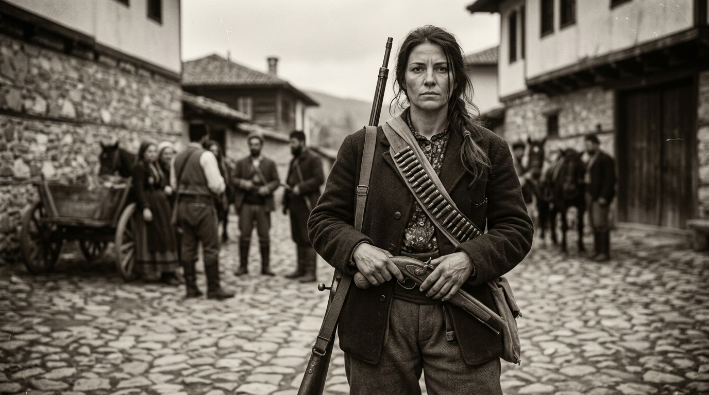

# /media - Claude Code Skill for AI Image Generation & Editing

A [Claude Code](https://docs.anthropic.com/en/docs/claude-code) custom skill that generates and edits images directly from your terminal using the OpenAI Images API.

Type `/media` in Claude Code and describe what you want to create.

## What It Does

- **Image Generation** via `gpt-image-2.6-flare` (default, fast) or `gpt-image-2.6-sunburst` (`hq`, higher quality)
- **Image Editing**: pass one or more existing images plus an instruction

> Video generation is not supported yet.

## Usage

```
/media image a futuristic city at sunset
/media image hq portrait a woman in traditional clothing
/media image square a minimalist logo design
/media edit photo.png make the sky purple
/media edit cat.png hat.png put the hat on the cat
```

### Options

| Keyword | Effect |
|---------|--------|
| _(default)_ | `gpt-image-2.6-flare`, landscape 1536x1024 |
| `hq`, `high quality`, `best` | `gpt-image-2.6-sunburst`, high quality |
| `portrait`, `vertical`, `mobile` | 1024x1536 |
| `square` | 1024x1024 |

## Installation

### 1. Get an OpenAI API Key

Create one at [platform.openai.com/api-keys](https://platform.openai.com/api-keys).

### 2. Set the Environment Variable

Add to your shell profile (`~/.zshrc`, `~/.bashrc`, etc.):

```bash
export OPENAI_API_KEY="your-api-key-here"
```

Then reload: `source ~/.zshrc`

### 3. Install the Skill

**Option A: Personal skill** (available in all your projects)

```bash
mkdir -p ~/.claude/skills/media
curl -o ~/.claude/skills/media/SKILL.md \
  https://raw.githubusercontent.com/bulgariamitko/cc-media/main/.claude/skills/media/SKILL.md
```

**Option B: Project skill** (available only in a specific project)

```bash
cd your-project
mkdir -p .claude/skills/media
curl -o .claude/skills/media/SKILL.md \
  https://raw.githubusercontent.com/bulgariamitko/cc-media/main/.claude/skills/media/SKILL.md
```

### 4. Verify

Open Claude Code and type `/media` - it should appear in the skill autocomplete.

## How It Works

1. You run `/media image <prompt>` or `/media edit <file> <prompt>`
2. Claude calls the OpenAI Images API via REST (curl)
3. The base64-encoded image is decoded and saved to your current directory
4. The file opens automatically on macOS

No dependencies required beyond `curl` and `python3` (both pre-installed on macOS/Linux).

## Models

| Model | ID | Use |
|-------|----|-----|
| **GPT Image 2.6 Flare** | `gpt-image-2.6-flare` | Default, fast (~7s) |
| **GPT Image 2.6 Sunburst** | `gpt-image-2.6-sunburst` | `hq` mode, higher quality (~25s) |

## Requirements

- [Claude Code](https://docs.anthropic.com/en/docs/claude-code) CLI
- An [OpenAI API key](https://platform.openai.com/api-keys) with access to the models above
- `curl` and `python3` (pre-installed on macOS/Linux)

## Example Output

Prompt: `/media image hq bulgarian revolutional woman from 1888 looking at the camera`



## License

MIT
